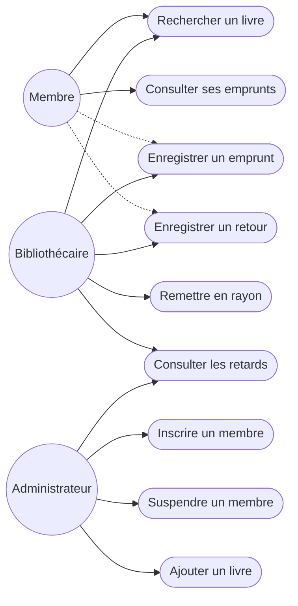
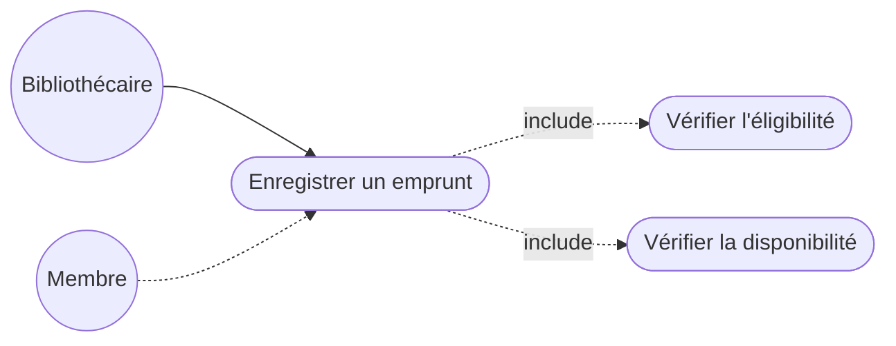
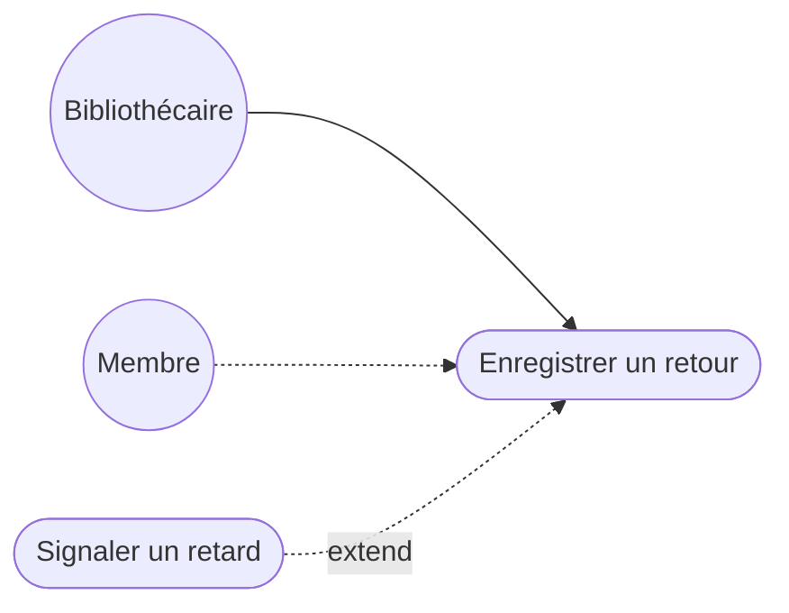
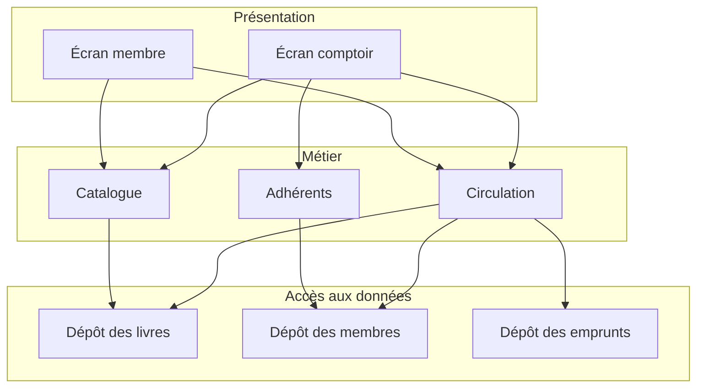
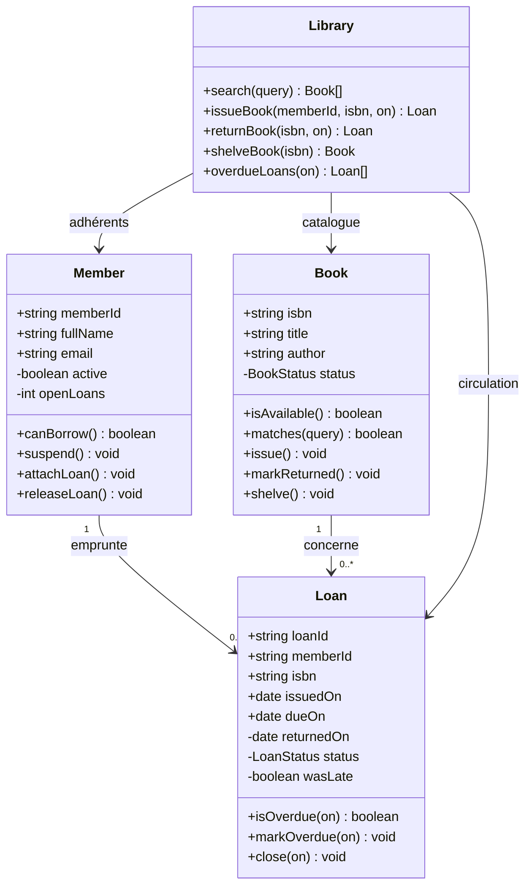
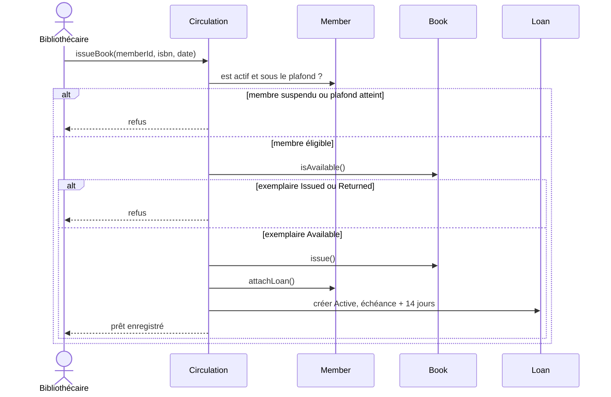
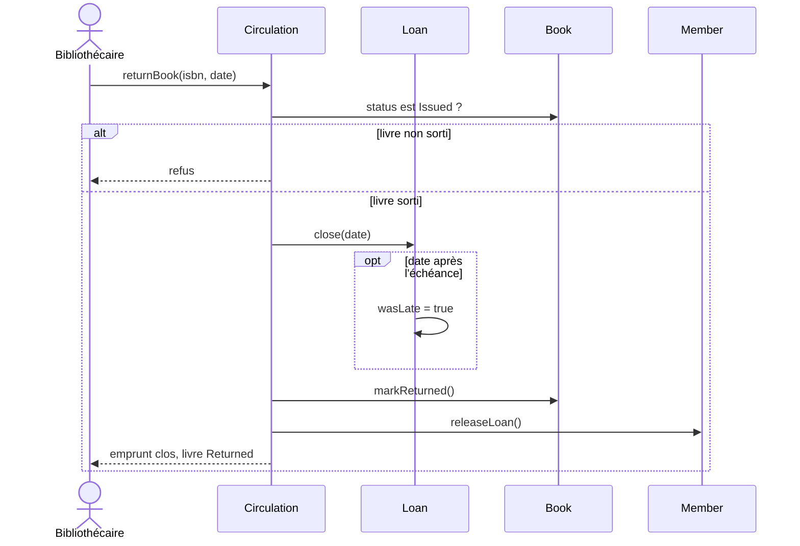
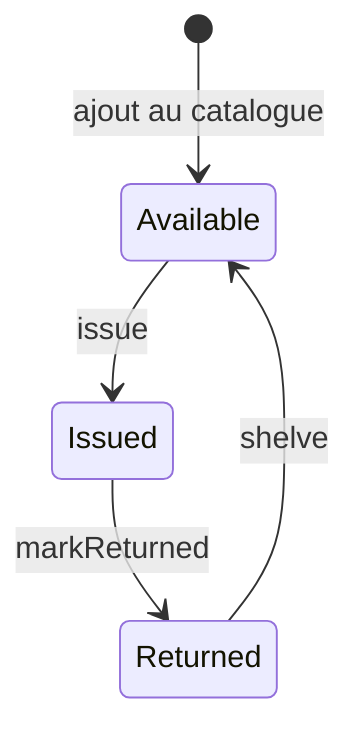
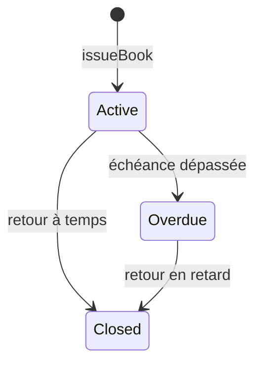
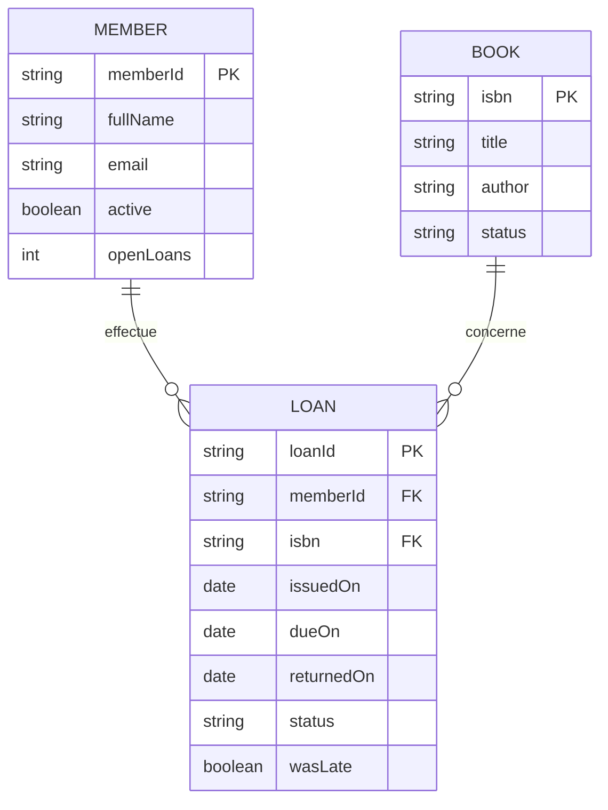

# Analyse d'un système de gestion de bibliothèque

Checkpoint GOMYCODE d'analyse orientée objet. Le sujet s'arrête avant la conception détaillée et avant un système complet : acteurs, cas d'utilisation, architecture, classes, et diagrammes. Le dossier `src/` est un croquis exécutable de ce modèle.

## Lancer le croquis

```bash
pnpm install
pnpm start
```

`pnpm start` rejoue les cas analysés : inscription, recherche, emprunt, refus d'un second emprunt du même exemplaire, retour, remise en rayon, retard, suspension.

```bash
pnpm typecheck
pnpm build
```

## 1. Analyse des besoins

Bibliothèque de quartier, un exemplaire physique par notice. Le membre cherche et emprunte. Le bibliothécaire enregistre les mouvements au comptoir. L'administrateur tient le catalogue et les comptes.

### Acteurs

| Acteur | Rôle | Primaire sur |
| --- | --- | --- |
| Membre | Cherche un livre, se présente pour emprunter ou rendre, consulte ses prêts | Recherche, consultation de ses emprunts |
| Bibliothécaire | Enregistre l'emprunt, le retour, la remise en rayon, consulte les retards | Emprunt, retour, remise en rayon |
| Administrateur | Inscrit ou suspend un membre, ajoute un livre, consulte les retards | Inscription, suspension, ajout au catalogue |

Le membre est acteur secondaire de l'emprunt et du retour : il est au comptoir, le bibliothécaire pilote le système. L'administrateur et le bibliothécaire sont deux rôles. Une même personne peut les cumuler. L'analyse les sépare parce que leurs droits ne sont pas les mêmes.

### Règles retenues

- Un exemplaire est empruntable seulement s'il est en rayon (`Available`).
- Un membre actif a au plus 3 emprunts ouverts.
- Un membre suspendu ne peut pas emprunter.
- La durée d'un prêt est de 14 jours.
- Le retard est un état de l'emprunt. Le livre reste `Issued` tant qu'il n'est pas rendu.
- Après le retour, l'exemplaire est `Returned` jusqu'à sa remise en rayon.

### Cas d'utilisation

| Cas | Acteur primaire | Objectif |
| --- | --- | --- |
| Rechercher un livre | Membre ou bibliothécaire | Trouver une notice par titre, auteur ou ISBN |
| Enregistrer un emprunt | Bibliothécaire | Sortir un exemplaire disponible pour un membre éligible |
| Enregistrer un retour | Bibliothécaire | Clore le prêt et marquer l'exemplaire rendu |
| Remettre en rayon | Bibliothécaire | Rendre l'exemplaire à nouveau empruntable |
| Consulter ses emprunts | Membre | Voir ses prêts, ouverts ou clos |
| Consulter les retards | Bibliothécaire ou administrateur | Lister les prêts dont l'échéance est dépassée |
| Inscrire un membre | Administrateur | Créer un compte actif |
| Suspendre un membre | Administrateur | Bloquer les futurs emprunts |
| Ajouter un livre | Administrateur | Créer une notice disponible |

### Vue d'ensemble



Le trait plein relie l'acteur primaire. Le trait pointillé relie l'acteur secondaire.

### Emprunt

L'emprunt inclut deux vérifications obligatoires. Sans elles, le scénario nominal n'existe pas.



### Retour

Le signalement de retard est optionnel : il étend le retour seulement si la date du jour dépasse l'échéance.



## 2. Architecture

Trois couches. Chaque couche a une seule raison de changer.

| Couche | Composants | Responsabilité |
| --- | --- | --- |
| Présentation | Écran membre, écran comptoir | Saisie, affichage, aucun calcul de prêt |
| Métier | Catalogue, Adhérents, Circulation | Règles : recherche, éligibilité, emprunt, retour, retard |
| Accès aux données | Dépôt des livres, dépôt des membres, dépôt des emprunts | Lire et écrire sans connaître les règles |



La circulation est le seul composant qui modifie à la fois un livre, un membre et un emprunt. Le catalogue ne prête pas. Le dépôt ne décide pas si un membre est suspendu.

Le croquis `Library` regroupe ces trois services en mémoire. Il montre leur collaboration. Il ne réalise ni l'écran, ni une base.

## 3. Analyse orientée objet

Les classes viennent des noms stables des cas d'utilisation. Chaque classe garde ses données et les transitions qui la concernent.

| Classe | Attributs | Méthodes | Responsabilité |
| --- | --- | --- | --- |
| `Book` | `isbn`, `title`, `author`, `status` | `isAvailable`, `matches`, `issue`, `markReturned`, `shelve` | Un exemplaire et son état |
| `Member` | `memberId`, `fullName`, `email`, `active`, `openLoans` | `canBorrow`, `suspend`, `reactivate`, `attachLoan`, `releaseLoan` | Le droit d'emprunter |
| `Loan` | `loanId`, `memberId`, `isbn`, `issuedOn`, `dueOn`, `returnedOn`, `status`, `wasLate` | `isOpen`, `isOverdue`, `markOverdue`, `close` | Un prêt dans le temps |
| `Library` | dépôts en mémoire | `addBook`, `registerMember`, `suspendMember`, `search`, `loansOf`, `issueBook`, `returnBook`, `shelveBook`, `overdueLoans` | Croquis de la couche métier |

`active` et `openLoans` restent privés. Le plafond de 3 prêts est appliqué dans `Member`, pas dans l'écran. L'état du livre est privé : seuls `issue`, `markReturned` et `shelve` le font changer, et seulement depuis l'état attendu.



Un livre a au plus un emprunt ouvert. L'historique autorise plusieurs emprunts clos, d'où la cardinalité `0..*`.

## 4. Diagrammes de séquence

### Enregistrer un emprunt



### Enregistrer un retour



La remise en rayon est un pas séparé : `shelve()` fait passer `Returned` à `Available`. Le diagramme d'états montre pourquoi ce pas existe.

## 5. Diagramme d'états du livre



`Issued` ne va pas vers `Available` directement. Un exemplaire rendu n'est pas encore en rayon. Un retard ne change pas cet automate : le livre reste `Issued`.

L'emprunt a son propre cycle.



## 6. Modèle de données



`openLoans` est un dérivé des emprunts ouverts. Le croquis le stocke sur le membre pour garder la règle d'éligibilité au même endroit. Dans une base, il se calcule par comptage des prêts non clos.

## 7. Modèle fonctionnel

Ce que le système fait, cas par cas.

### Rechercher un livre

- Précondition : la requête n'est pas vide.
- Scénario : le catalogue compare la requête au titre, à l'auteur et à l'ISBN, sans tenir compte de la casse.
- Postcondition : la liste des notices correspondantes, avec leur état. Un livre sorti reste visible.

### Enregistrer un emprunt

- Préconditions : le membre existe, le livre existe.
- Scénario : vérifier que le membre est actif et a moins de 3 prêts ouverts, vérifier que le livre est `Available`, passer le livre à `Issued`, incrémenter le compteur, créer un emprunt `Active` dû 14 jours plus tard.
- Alternatives : membre inconnu, livre inconnu, membre suspendu, plafond atteint, exemplaire déjà sorti ou pas encore rangé.
- Postcondition : un seul emprunt ouvert lie ce membre à cet ISBN.

### Enregistrer un retour

- Précondition : le livre est `Issued` et un emprunt ouvert porte son ISBN.
- Scénario : clore l'emprunt, noter le retard si la date dépasse l'échéance, passer le livre à `Returned`, décrémenter le compteur du membre.
- Postcondition : plus aucun emprunt ouvert pour cet ISBN. Le livre n'est pas encore empruntable.

### Remettre en rayon

- Précondition : le livre est `Returned`.
- Postcondition : le livre est `Available`.

### Consulter les retards

- Scénario : parcourir les emprunts ouverts dont la date du jour dépasse `dueOn`, les passer de `Active` à `Overdue`.
- Postcondition : la liste des prêts en retard. Les livres concernés restent `Issued`.

### Inscrire, suspendre, ajouter

- Inscrire crée un membre actif avec zéro emprunt. Refus si l'identifiant existe.
- Suspendre bloque les emprunts futurs. Les prêts déjà ouverts restent dus.
- Ajouter crée un livre `Available`. Refus si l'ISBN existe.

## 8. Modèle comportemental

Le comportement dans le temps est la combinaison des deux automates et des séquences.

1. Ajout : le livre naît `Available`.
2. Emprunt : `Available` → `Issued`, emprunt `Active`, échéance fixée.
3. Si la date dépasse l'échéance avant le retour : emprunt `Active` → `Overdue`, livre inchangé.
4. Retour : emprunt → `Closed`, livre `Issued` → `Returned`. `wasLate` mémorise le dépassement.
5. Remise en rayon : `Returned` → `Available`. Un nouvel emprunt redevient possible.

La suspension n'annule pas un prêt ouvert. Elle empêche seulement le prochain `issueBook`.

## 9. De l'abstraction au code

Le croquis reprend les classes du diagramme. `Book` encapsule la transition. Un appel hors de l'état attendu est refusé.

```ts
issue(): void {
  this.#move(BookStatus.Available, BookStatus.Issued);
}

#move(from: BookStatus, to: BookStatus): void {
  if (this.#status !== from) {
    throw new Error(`« ${this.title} » est ${this.#status} : passage vers ${to} impossible.`);
  }
  this.#status = to;
}
```

`Library.issueBook` enchaîne les deux includes du cas d'utilisation, puis seulement les écritures.

```ts
if (!member.isActive) {
  throw new Error(`${member.fullName} est suspendu.`);
}
if (member.openLoans >= MAX_OPEN_LOANS) {
  throw new Error(`${member.fullName} a atteint le plafond de ${MAX_OPEN_LOANS} emprunts.`);
}
if (!book.isAvailable()) {
  throw new Error(`« ${book.title} » n'est pas disponible (${book.status}).`);
}
book.issue();
member.attachLoan();
```

| Fichier | Rôle dans le modèle |
| --- | --- |
| `src/domain/Book.ts` | Automate de l'exemplaire |
| `src/domain/Member.ts` | Éligibilité et plafond |
| `src/domain/Loan.ts` | Prêt, échéance, retard |
| `src/domain/rules.ts` | 14 jours, 3 emprunts |
| `src/library/Library.ts` | Collaboration des cas d'utilisation |
| `src/index.ts` | Scénario qui parcourt les états |

Hors de ce checkpoint : écrans, persistance, réservation, pénalité chiffrée, plusieurs exemplaires d'une même notice, patterns de conception.
